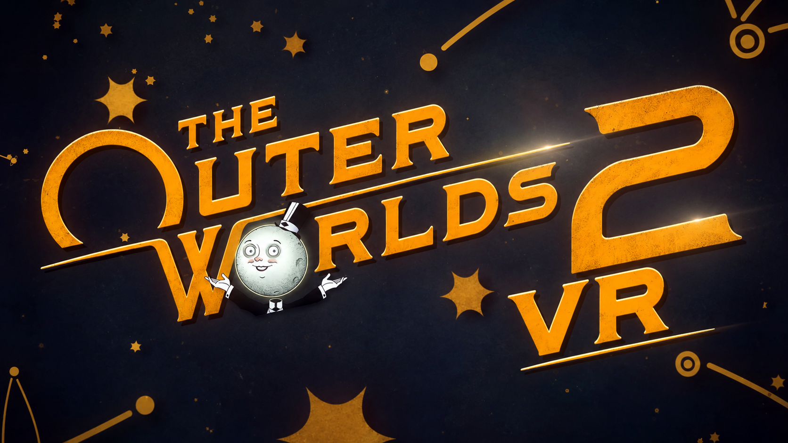

# The Outer Worlds 2 – UEVR VR Profile

A full motion-controller VR conversion of The Outer Worlds 2 for UEVR, with visible hands, physical weapon handling, two-handed aiming, picture-in-picture scopes, body holsters, weapon recoil, physical melee and a stable, comfortable camera. Special thanks to praydog, jbusfield (for his libs framework), and joeyhodge!

NOTE: PERFORMANCE IS ROUGH AND I DO NOT KNOW WHY!

## IMPORTANT!

- My custom UEVR backend is required - see releases to download this. Version 1.6 of the profile needs UEVR release 2026-11-02.2 or newer (it fixes engine name lookups on this game, which the scopes rely on).

## Features

### Hands and weapons

- **Visible VR hands, two ways.** A "Hands Mode" panel lets you pick either glove hands, cut down from the game's own arm mesh so they match the suit, or full IK arms that reach from your shoulders to the controllers with elbows solved in between. Switch between them live, no reset. Both appear automatically on every level load.
- **Hands follow your outfit.** Change suit or armor in the inventory and the hands or arms rebuild themselves with the new model and skin within half a second, and come back already holding your current weapon's grip pose.
- **Per-weapon grip poses.** The hands wrap around each weapon type correctly, with separate grip and trigger poses for pistol, revolver, SMG, machine pistol, rifle, assault rifle, shock rifle and baton. One pose set drives both glove hands and IK arms.
- **Per-weapon hand placement.** Every weapon has its own hand position and rotation offset, tuned separately for glove hands and IK arms, so the hand sits on the grip properly on each gun.
- **Natural IK wrists.** In IK mode the forearm twist bones follow your wrist roll, so the forearms turn with the hand instead of twisting like a candy wrapper.
- **Weapon in hand.** The equipped weapon is attached to your right controller and aims where you point it, with a per-weapon position and rotation offset. Bullets go where the barrel points via a small native aim-fix plugin.
- **Two-handed aiming.** On rifles and other long guns, reach your left hand to the fore-grip and hold the left trigger to grab it. The weapon then pivots between both hands. The left hand takes a grip pose captured from the game's own animation for that weapon and holds it for the whole grab, with the left trigger ignored for finger animation while you're gripping. Works in both hand modes; in IK mode both arms are solved onto the gun, so the right hand turns with the weapon as it pivots and the left arm follows the fore-grip.
- **Picture-in-picture scopes.** Weapons fitted with a magnifying scope get a working scope you look through. It only appears when your eye is at the eyepiece and switches off when you lower the gun. The scope camera sits on the muzzle and looks straight down the barrel, so the centre of the scope is where your shot goes, and the gun's own scope model can't block the view. It follows the sight actually fitted: a scope mod added at the workbench adds the PiP, a holographic sight removes it. Zoom with the right stick while looking through it. Settings are saved per sight.
- **Weapon recoil.** Each shot kicks the gun in your hand, driven by the game's own arm animation, in both hand modes and while two-handing.
- **Body holsters.** Press the right grip with your hand at your right hip, right shoulder, left shoulder or left hip to switch to weapon slots 1, 2, 3 or 4. A short buzz tells you when your hand is in a holster zone.
- **Flashlight gesture.** Press the left grip with your left hand in front of your face to toggle the flashlight.
- **Gadgets in the left hand.** The Dematerializer acid spray is held in your left hand while you use it.
- **Physical melee.** With a melee weapon out, a fast swing left, right or down attacks when overlapping with an enemy.
- **Reticule.** Dynamic reticule on by default, can be toggled off/on and change brightness.
- **Reload fix.** Reloads always refill the magazine, which the game otherwise skips in VR.
- **Clean weapon swaps.** The game's own arm mesh no longer flashes on screen when switching weapons, and weapon mods such as magazines render with their proper textures.

### Camera and movement

- **Steady camera.** Head bob, camera shake, melee camera animations and weapon-kick camera effects are all disabled. The first-person camera is taken off the animated arm socket the game bobs it with, so walking, sprinting and swinging no longer shake the view.
- **Correct eye height.** The VR camera sits at the character's real eye level rather than the top of the collision capsule.
- **Head-directed movement.** Push forward and you walk where you're looking. The right stick still turns you. Sprinting runs straight, with no drift.
- **Decoupled pitch.** Looking up and down does not tilt the game camera, so no motion-sickness pitch coupling.
- **Depth-correct weapon rendering.** Weapons, mods and hands are moved out of the game's flat foreground pass so they sit at the right depth in stereo, with no black or missing parts.

### Interface and comfort

- **UI that moves with context.** The HUD and menus sit at a comfortable distance normally and pull in close during conversations and terminal use, driven by the game's zoom.
- **Conversation and cutscene handling.** Camera offsets, UI placement and hands adjust automatically in dialogue and cutscenes. In scripted cutscenes the IK arms are hidden and VR input is paused, so the arms no longer float above you and the character appearance screen shows your character properly.
- **Clean full-screen menus.** Native Stereo Fix switches off automatically in the inventory (ledger), companion selection, trading and workbench screens, and comes back on when you close them. In those menus the controls are the plain flat-game ones (no left grip / trigger swap).
- **Controller face-button swap.** X and B are swapped on the gamepad mapping for a more natural VR layout.

## Controls

| Action | Input |
|---|---|
| Move | Left stick, relative to where you look |
| Turn | Right stick |
| Aim / fire | Point the right controller, right trigger |
| Two-hand a long gun | Bring the left hand to the fore-grip and hold the left trigger |
| Melee attack | Swing the right controller left, right or down with a melee weapon equipped |
| Weapon slot 1 / 2 / 3 / 4 | Right grip with the right hand at the right hip / right shoulder / left shoulder / left hip |
| Flashlight | Left grip with the left hand in front of your face |
| Look through a scope | Bring the scope's eyepiece up to your eye |
| Scope zoom | Right stick up / down while looking through a scope |
| Menus and terminals | Right-hand laser pointer |

## Installation

1. Install my custom UEVR.
2. Import the relevant profile you want to use (GDK=Gamepass, AFW=AFW rendering method).
3. Inject UEVR at the main menu.

## Tuning

Everything is adjustable from the **Outer Worlds 2 VR** panel in the UEVR overlay, without editing files:

- **Hands** – glove hands or IK arms.
- **Two-Handed Aiming** – fore-grip point, grab radius and left-hand pose per weapon.
- **Weapon Recoil** – on/off, kick distance and rotation strength, kick while two-handing, and recovery time.
- **Holsters** – on/off, haptic pulse, zone sizes and positions, with a live readout of where each hand is.
- **PiP Scope** – on/off, zoom range, brightness, lens size and position, and the eye distance at which the scope appears. Saved per sight, for the sight currently equipped, with a live readout of the eye distance.
- **Physical Melee** – swing sensitivity, cooldown and animation speed.
- **Camera Stabilize** – individual toggles for head bob, camera shake, camera animations, weapon kick, and the camera-rotation source.
- **UI & Conversations**, **Controls** (left grip / trigger swap, ADS zoom off), **Weapon Reticule** and **Interaction Pointer**.

## Under the hood

Built on the shared uevrlib Lua framework, running on the joeyhodge UEVR backend with the alternate frame warp render method. Game-specific logic lives in a handful of small scripts on top of the framework: weapon attachment and rendering fixes, two-handed aiming, physical melee, camera stabilisation, the hands bootstrap with outfit tracking, and the conversation/UI handling.

The shared library carries a few fixes specific to this game and backend: freshly spawned objects are not visible to UEVR's object tracker for several seconds, so controller creation, hand teardown and finger animation no longer gate on that tracker. Without these, hands would only appear after a script reset, quick outfit changes could leave duplicate hands, and level changes could throw per-frame animation errors.

The IK module needed the same treatment plus two more: bone lookups in the solver go through an explicit engine-name conversion, and the rig's height is anchored to the top of the collision capsule so crouching keeps the shoulders level with the camera. The game compiles its engine-name constructor inline, so UEVR could not build names from plain strings at all; the custom backend now finds the constructor through the game's own string-to-name function, which fixes this for every script.

Scopes are decided from the game's own sight data: each sight asset has a flag saying whether it is a magnifying scope, and the profile reads the sight actually fitted to the weapon (a mod's sight overrides the base one). The scope camera ignores the weapon and everything attached to it, so the gun's own scope model never blocks the picture. Two-handing in IK mode reuses the library's accessory hook, which lets a hand's IK target follow a point on another component instead of the controller. Glove hands and IK arms share one set of animation ids, which is why they are a mode switch rather than a pair of toggles.
